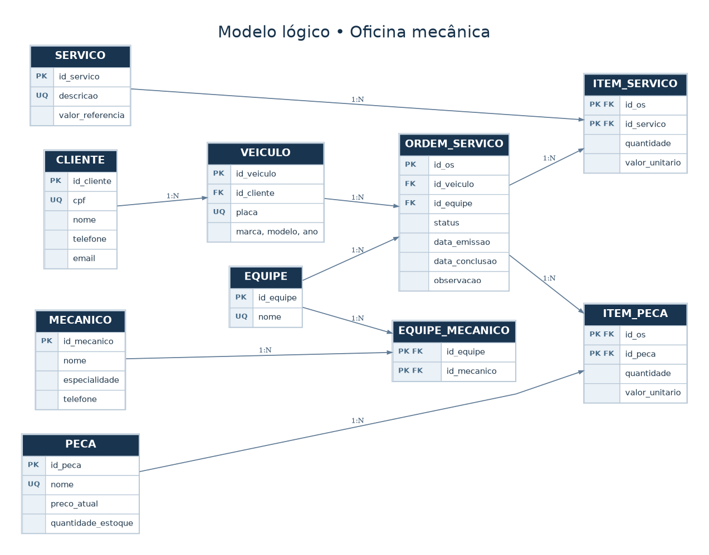

# Banco de Dados — Oficina Mecânica

## Sobre o projeto

Neste desafio, criei um banco de dados para uma oficina mecânica usando PostgreSQL. A ideia foi organizar as informações dos clientes, seus veículos, os mecânicos e os serviços realizados na oficina.

Primeiro, montei o modelo lógico com as tabelas e seus relacionamentos. Depois, criei os comandos SQL para montar o banco, adicionei alguns dados de exemplo e fiz consultas para testar o funcionamento.

## O que foi feito

O projeto possui **10 tabelas**, com chaves primárias, chaves estrangeiras e algumas regras para evitar dados incorretos. As ordens de serviço registram o veículo atendido, a equipe responsável, os serviços feitos e as peças utilizadas.

Também preparei **18 consultas SQL**, usando `SELECT`, `WHERE`, `ORDER BY`, `GROUP BY`, `HAVING` e `JOIN`, além de cálculos.

Com essas consultas, é possível descobrir quantos serviços foram feitos, quais mecânicos fazem parte de cada equipe e quanto custa uma ordem de serviço.

## Modelo lógico

## Arquivos do projeto

- `01_criar_esquema.sql` — cria as tabelas do banco.
- `02_inserir_dados.sql` — adiciona dados para testes.
- `03_consultas.sql` — contém as consultas SQL.
- `04_testes_integridade.sql` — testa as regras do banco.
- `diagramas/` — contém o modelo lógico.

## Como executar

O projeto foi desenvolvido para PostgreSQL. Para testar, basta abrir o pgAdmin 4, selecionar um banco de testes e executar os três primeiros arquivos SQL na ordem indicada.

O primeiro script recria o esquema `oficina`, por isso é importante utilizá-lo apenas em um ambiente de testes.
